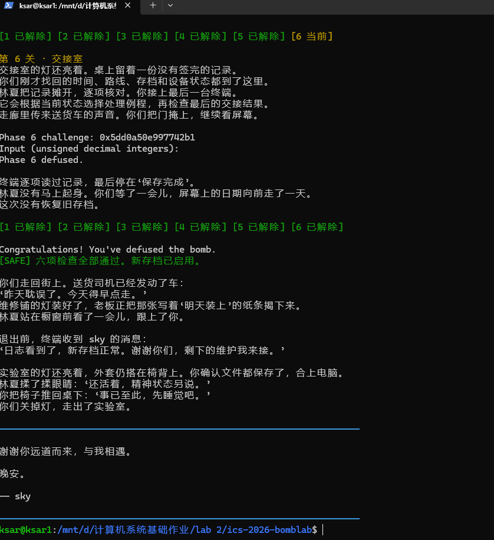
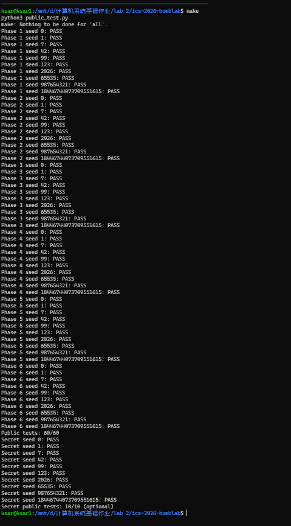

# Lab 2：BombLab 实验报告

> **AI 使用说明**：本报告文本由 OpenAI Codex 协助起草、重写与整理；Codex 也协助解释汇编、形成并检查求解实现、运行编译与测试。AI 参与了分析、代码实现和验证，不只是检查代码。本人对最终提交内容负责，并能说明各关的关键计算关系。

## 实验目标与方法

实验要求根据每关运行时提供的 64 位 `challenge`，从个人 bomb 的反汇编中恢复输入校验关系，并在 `defuser.c` 中实现可适用于不同 challenge 的计算。常规六关的答案都是由 challenge 计算出来的，不是公开 seed 对应的固定答案。Honor 关还会使用前六行答案计算出的 `context`。

分析时主要关注每个 `phase` 的输入解析、参数传递、条件跳转和最终比较；遇到辅助函数或表驱动分支时，再检查对应函数和只读数据区。常规关的无符号运算按 32 位结果理解；右移、异或、掩码和循环移位均按实际寄存器宽度还原。

## 第一关：参数计算

`phase_01` 读取一个无符号整数，并与 `p1_compute(challenge)` 返回值比较。`p1_compute` 把 challenge 的低 32 位、高 32 位和右移 16 位后的低 32 位分别用于三段计算；`p1_step0/1/2` 中的 `lea` 执行乘加，`xor` 执行按位异或。

令 `L = low32(challenge)`、`H = low32(challenge >> 32)`、`M = low32(challenge >> 16)`，则：

```text
t2 = (5 * H + L) XOR 0x6d13
t0 = (L + 8 * M) XOR 0xe797
answer = (t2 + 0xc884) XOR t0
```

`values[0]` 保存 `answer`，本关输出一个数。

## 第二关：六项递推

`phase_02` 要求 `sscanf` 成功读出六个整数。首项由 challenge 右移 40 位后取低 32 位得到；循环每轮从 challenge 中截取 5 位，与前一项相加，再异或 `6*i`。循环计数从 1 到 5，因此后续共生成五项。

```text
v[0] = (((low32(challenge >> 40) * 2) AND 0x1e) + 2)
对于 i = 1..5：
    part = (challenge >> (i + 18)) AND 0x1f
    v[i] = (part + v[i-1]) XOR (6*i)
```

答案是按顺序输出的 `v[0]` 到 `v[5]`。这关对应数组下标、循环和递推关系。

## 第三关：选择器与跳转表

`phase_03` 读取两个整数。最低三位选择第一个整数应等于的 selector；`p3_dispatch` 使用跳转表选择计算函数。输入的第二个整数等于选中函数的返回值。

令 `s = challenge AND 7`，`x = low32(challenge >> 32) XOR low32(challenge >> 3)`。跳转表对应关系和结果为：

| `s` | 计算结果 |
|---:|---|
| 0 | `5*x + 0x436de` |
| 1 | `(x XOR 0xfc30) + (x >> 2)` |
| 2 | `5*x + 0xd48a` |
| 3 | `5*x + 0xc723` |
| 4 | `5*x + 0x5b36` |
| 5 | `(2*x) XOR 0x8d1f` |
| 6 | `(x XOR 0x113f) + (x >> 1)` |
| 7 | `(2*x) XOR 0x11f9` |

两项输入依次为 `s` 和对应的计算结果。这个阶段需要结合跳转表的表项地址与各 `p3_case` 函数，而不能把 case 地址顺序误当作 selector 顺序。

## 第四关：二分递归与返回值组合

`phase_04` 读取一个整数，并将它与 `p4_walk` 的结果比较。目标值是 challenge 的低 7 位；递归在 `[0,127]` 范围内二分查找。每层根据目标落在中点左侧或右侧递归，返回时再组合子调用结果、中点和分支常量。

令 `target = low32(challenge) AND 0x7f`，`salt = low32(challenge >> 7) XOR low32(challenge >> 32)`。每层中点为 `mid = low + (high-low)/2`。命中时：

```text
result = (mid + 0x31) XOR salt
```

递归返回时令 `branch = mid + salt`：

```text
左分支（target < mid）：result = (3*result XOR branch) XOR 0x0c
右分支（target > mid）：result = (3*result XOR branch) XOR 0x15
```

从最深层开始按实际递归路径逆序应用这些返回操作。实现用数组记录路径上的 `branch` 和分支常量，再从栈顶向上还原递归返回过程。

## 第五关：结构体、指针表与链表

`p5_traverse` 处理一组固定节点。每个节点占 16 字节，可按以下布局理解：

```c
struct Node {
    struct Node *next;  // 偏移 0，8 字节
    uint32_t value;     // 偏移 8，4 字节
    uint32_t tag;       // 偏移 12，4 字节
};
```

反汇编中的 `mov 0x405b20(,%rax,8),%rdx` 从起始指针表按 8 字节表项取节点地址；`and $7` 得到表索引。challenge 的 `(challenge >> 3) AND 3` 决定沿 `next` 走的步数。初始累计值包括起始节点的 `value` 和 `tag`；每到一个后续节点，按 `(result XOR tag) + value` 更新累计值，同时记录最后一个节点的 `value`。

```text
head = heads[challenge AND 7]
hops = (challenge >> 3) AND 3
result = (low32(challenge >> 6) XOR low32(challenge >> 32)
          XOR head.tag XOR 0x9843) + head.value
重复 hops 次：
    head = head.next
    result = (result XOR head.tag) + head.value
```

两个输入依次是最终 `result` 和最后访问节点的 `value`。起始指针表的次序与节点在内存中的排列次序不同，所以需要跟随指针字段，而不能按地址连续顺序遍历。

## 第六关：函数指针表与间接调用

`phase_06` 读取一个整数。`p6_dispatch` 从 challenge 计算初始 `x`，用低三位选择第一次运算，用第 3 到第 5 位选择第二次运算；两次运算之间先异或 `0x214e`，最后加 `0x3c60`。

```text
x = low32(challenge >> 6) XOR low32(challenge >> 32)
first_index = challenge AND 7
second_index = (challenge >> 3) AND 7
x = op[table[first_index]](x)
x = x XOR 0x214e
x = op[table[second_index]](x)
answer = x + 0x3c60
```

函数指针表的 8 个 selector 映射为 `[2, 2, 0, 4, 5, 3, 1, 3]`，其中数字指向 `p6_op_0` 到 `p6_op_5`。这些函数分别实现 32 位循环右移 7 位、异或后乘加、右移异或加常数、两个线性表达式异或、加常数后与右移结果异或、以及循环左移 1 位后异或常数。`ror`/`rol` 是循环移位，移出的位会从另一端绕回；它们不是普通的 `shr`/`shl`。

## Honor 隐藏关

`secret_gate` 先复制输入行，并检查偏移 32 处的四个字符为 `OPEN`；之后 `secret_phase` 要求从 `OPEN` 后解析出三个无符号整数。实现用 32 个字符的前缀，再接 `OPEN` 和三个计算值。门禁检查还限制整行长度，因此答案必须同时满足前缀位置、格式和后续数值比较。

令 `C = low32(challenge) XOR low32(challenge >> 32)`，`K = low32(context) XOR low32(context >> 32)`，`r = low32(context) AND 3`。`secret_mix(z)` 对 32 位 `z` 循环左移 3 位，加 `0x9555`，再异或 `0xd26d`。三项输入关系为：

```text
first = r
second = secret_mix(C XOR K)
         XOR ((0x9555*r) XOR low32(context >> 16))
third = second XOR (K + r + 0xd26d + (C >> 3))
```

所有加法和异或均按 32 位无符号结果处理。`context` 来自前六关答案行，因此 Honor 必须和相同 seed 下的前六行答案一起验证。

## 验证记录

在本地 Linux/WSL 环境使用仓库的 `gcc -std=c11 -O2 -Wall -Wextra -Wpedantic -Werror` 编译。

| 测试 | 结果 |
|---|---:|
| 六个常规关卡公开测试 | 60/60 通过 |
| Honor 公开测试 | 10/10 通过 |
| 非公开 seed `1337` 的六关及 Honor 完整流程 | 通过 |
| 以 `random.Random(0xB0B)` 生成的 128 个 64 位 seed，六关及 Honor 完整流程 | 128/128 通过 |

随机 seed 是额外的本地稳健性检查，不是课程的隐藏测试，也不能替代课程评分。课程隐藏 challenge/seed 未在本地运行。

复现公开测试：

```sh
make
python3 public_test.py
```

非公开 seed `1337` 的完整流程由测试脚本的 `check_seed` 检查；额外 128 个 seed 使用同一个检查函数逐个验证。测试会先生成六行答案并交给 bomb，再生成并验证 Honor 输入。

## 运行与测试截图

第一张截图记录个人 bomb 的六个常规关卡全部解除及最终结局提示；第二张截图记录编译状态、常规关卡公开测试 60/60 和 Honor 公开测试 10/10。图片随报告放在 images/ 目录中。





## AI 与其他辅助工具使用说明

本报告文本由 OpenAI Codex 协助起草、重写与整理。Codex 也用于阅读仓库说明、解释 x86-64 汇编和 challenge/context 的计算关系、协助形成并检查 defuser.c 的求解实现，以及运行编译与测试。AI 参与了分析、代码实现和验证，不只是检查代码。本人对最终提交内容负责，并能说明各关的关键计算关系。

其他资料：仓库 `README.md`、个人 bomb 的 `objdump` 反汇编与 `.rodata` 数据、仓库自带 `public_test.py`。未引用其他外部解答或同学代码。


